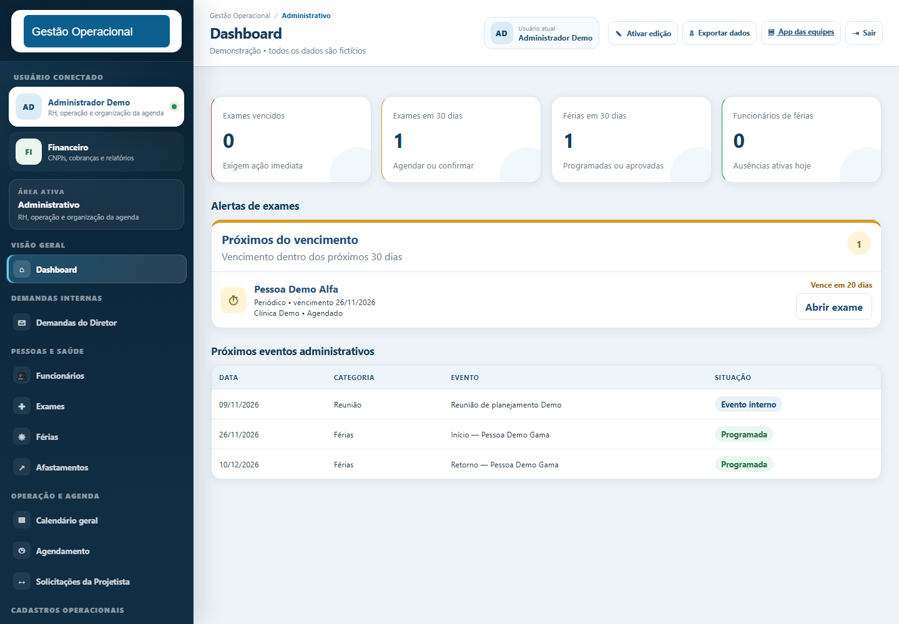

# Sistema de Gestão Operacional — Demo

Aplicação web de portfólio para coordenar pessoas, equipes de campo, obras, agenda, frota e financeiro. A proposta é mostrar fluxos de negócio conectados, controle de acesso e persistência — com um cenário inteiramente fictício que pode ser executado localmente sem contas de terceiros.

**Comece por:** executar a aplicação, entrar com a conta demo e explorar Dashboard → Funcionários → Agenda → Frota → Financeiro.



## Execução rápida

Requisitos: **Python 3.12**, pip e navegador moderno. Execute os comandos na raiz do projeto.

Windows / PowerShell:

```powershell
python -m venv .venv
.\.venv\Scripts\python.exe -m pip install -r requirements.txt
Copy-Item .env.example .env
.\.venv\Scripts\python.exe -m uvicorn app.main:app --host 127.0.0.1 --port 8000
```

Linux / macOS:

```bash
python3 -m venv .venv
.venv/bin/python -m pip install -r requirements.txt
cp .env.example .env
.venv/bin/python -m uvicorn app.main:app --host 127.0.0.1 --port 8000
```

Abra [a apresentação local](http://127.0.0.1:8000) e escolha **Explorar demonstração**.

| Acesso | Valor |
| --- | --- |
| E-mail | `demo@portfolio.local` |
| Senha | `Demo@12345` |
| Perfil | Administrador Demo |
| Portal das equipes (`/app`) | `pessoa.demo1` / `DemoPortal123` |

As credenciais são públicas e válidas exclusivamente no modo demo. O cenário inicial inclui três colaboradores, duas equipes, uma empresa e uma obra, agendamentos relativos à data atual, dois veículos, exame, férias e cobrança fictícia. Posições e trajetos da frota são simulados.

Não é necessário instalar PostgreSQL nem configurar Supabase, Selsyn, OpenAI ou serviços financeiros. Bibliotecas visuais, mapas e OCR no navegador podem precisar de internet; o servidor, login e dados demo são locais.

## Funcionalidades

- **Pessoas:** colaboradores, exames, férias, afastamentos e importação de fichas em PDF com revisão.
- **Operações:** empresas, obras, equipes, diárias, agenda e revisão de lançamentos históricos.
- **Agenda em tablet:** desenho, revisão, confirmação idempotente e publicação na agenda central.
- **Frota:** posições simuladas, trajetos, paradas, alertas, geofences, abastecimento, custos e manutenção.
- **Financeiro:** lançamentos, cobranças e vínculos entre serviços, diárias e faturamento.
- **Projetos:** clientes, orçamentos, documentos e acompanhamento de processos.
- **Acesso:** sessão por cookie, autorização por perfil, portal das equipes e histórico de versões do estado central.

Certificados privados, fotos de perfis e compromissos financeiros manuais que usam Supabase não são emulados na demo. Os adaptadores correspondentes continuam no código; a interface pode informar que a integração está indisponível. Veja as limitações em [PORTFOLIO_NOTES.md](PORTFOLIO_NOTES.md).

## Stack e arquitetura

| Camada | Tecnologias / responsabilidade |
| --- | --- |
| HTTP | FastAPI, Pydantic, Uvicorn |
| Interface | Jinja2, HTML, CSS, JavaScript e Leaflet |
| Persistência local | SQLite, transações, índices e WAL |
| Arquivos | armazenamento local, pypdf, validações de tipo/tamanho |
| Adaptadores reais | Supabase, Selsyn, WhatsApp Cloud API, Cora, IPM/NFS-e, OpenAI, IMAP |
| Qualidade | pytest/unittest, testes JavaScript com Node.js |

```text
app/
  main.py               composição, lifespan, autorização e rotas operacionais
  routes/pages.py       páginas públicas, login e agenda em tablet
  auth.py               contrato de autenticação e sessões
  demo_auth.py          autenticação local com tokens aleatórios e hash no SQLite
  demo_seed.py          cenário sintético com referências coerentes
  settings.py           configuração e isolamento das integrações
  system_state.py       estado central, revisão otimista e histórico
  operations.py         regras e persistência da frota
  calendar_service.py   consolidação de eventos operacionais
  *_client.py           adaptadores de serviços externos
  templates/            interface renderizada pelo servidor
assets/                  recursos do navegador
migrations/              migrações aditivas para instalações reais
tests/                   testes de domínio, APIs, segurança e interface
docs/                    documentação técnica e capturas da demo
data/                    criado em execução; não versionado
```

As regras de negócio existentes foram preservadas. A separação de páginas, autenticação demo e seed reduz o acoplamento sem exigir uma reescrita do sistema. `main.py` e a interface principal ainda concentram responsabilidades; são pontos de evolução documentados, não uma arquitetura apresentada como final.

## Modo demo e persistência

`DEMO_MODE=true` é o padrão, inclusive sem `.env`. Os bancos e documentos usam `data/demo/`. O seed do estado central só é aplicado quando ainda não existe estado: reiniciar não apaga edições feitas durante a avaliação. Sessões locais têm expiração e logout; somente o hash do token é persistido.

Para reiniciar o cenário, pare o servidor, remova **somente `data/demo/` desta cópia** e inicie novamente. Preferências e cópias locais podem ser limpas no armazenamento do navegador.

## Integrações reais

Por padrão `INTEGRATIONS_ENABLED=false`. No modo demo, credenciais externas são ignoradas e rotas que enviam mensagens, processam pagamentos, sincronizam e-mails ou consultam visão externa são bloqueadas. Nenhuma cobrança, nota fiscal ou mensagem real é gerada pela demo.

Para uma instalação operacional, são necessárias **as duas opções** `DEMO_MODE=false` e `INTEGRATIONS_ENABLED=true`, credenciais próprias e ativação individual dos serviços. Consulte `.env.example`. Use `AUTH_COOKIE_SECURE=true` com HTTPS. Não reutilize bancos ou credenciais de uma organização sem autorização.

O pacote preserva migrações incrementais, mas não inclui um provisionamento completo de todas as tabelas legadas de Supabase. A execução operacional requer uma instalação compatível; **a execução demo é o caminho independente e validado deste repositório**.

## Testes

```powershell
.\.venv\Scripts\python.exe -m pip install -r requirements-dev.txt
.\.venv\Scripts\python.exe -m pytest -q
.\.venv\Scripts\python.exe -m compileall -q app
node --test tests/*.test.js
```

Em Linux/macOS, substitua o executável por `.venv/bin/python`. Node.js 20+ é necessário apenas para os testes JavaScript. Os testes Python isolam os bancos em diretórios temporários. Testes de adaptadores usam clientes simulados; o fluxo demo verifica startup, login, sessão, dados, persistência, logout e bloqueio de conexões externas.

As versões instaladas e verificadas estão em `requirements-lock.txt`; para reproduzir esse ambiente, instale esse arquivo no lugar de `requirements.txt`. Resultados e escopo de validação estão em [docs/VALIDATION.md](docs/VALIDATION.md).

## Decisões técnicas

- **SQLite na demonstração:** reduz o custo de instalação e mantém transações e persistência reais.
- **Adaptadores preservados:** o portfólio mostra pontos de integração sem depender de uma infraestrutura privada.
- **Seed centralizado:** elimina cadastros pessoais e históricos operacionais embutidos em templates.
- **Estado com revisão:** preserva histórico e detecta alterações concorrentes; não substitui uma modelagem relacional completa para cenários maiores.
- **Refatoração incremental:** prioriza comportamento verificável e compatibilidade dos módulos existentes.

Este repositório é uma adaptação de portfólio de uma aplicação operacional existente. Não inclui alegações de autoria individual, métricas de produção ou clientes reais. Veja [PORTFOLIO_NOTES.md](PORTFOLIO_NOTES.md) e [CHANGELOG.md](CHANGELOG.md).
