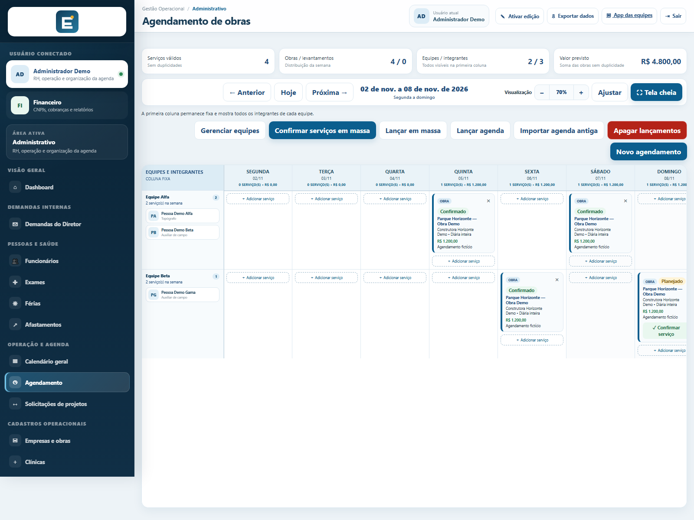
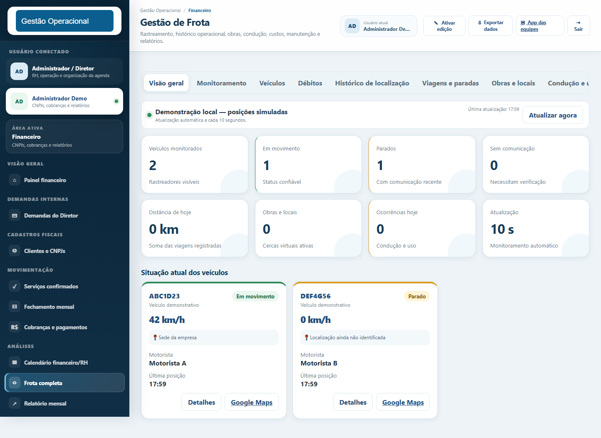
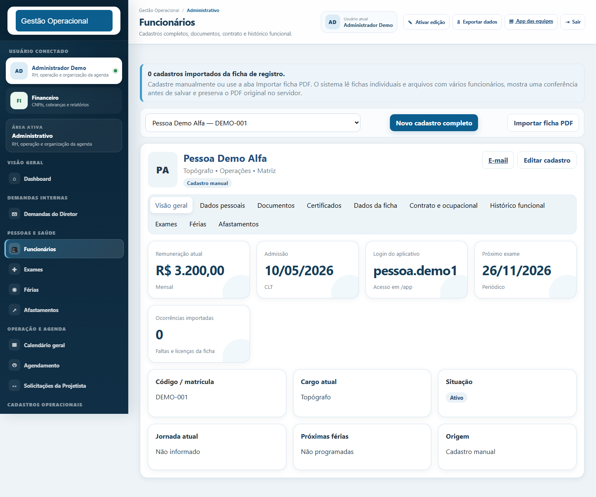
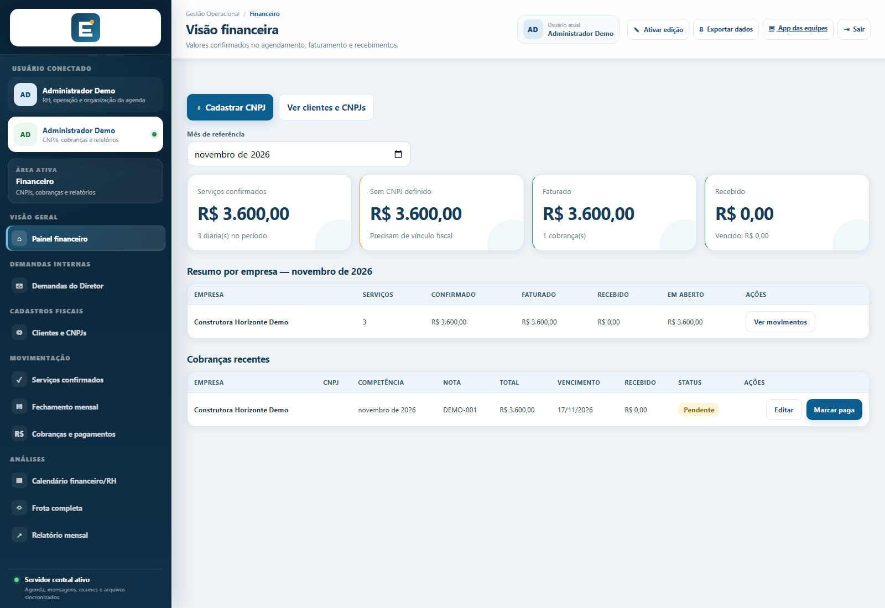

<div align="center">


# Sistema de Gestão Operacional

**Uma aplicação web para centralizar operações, pessoas, agenda, frota e financeiro.**

Case de engenharia de software desenvolvido por **Hendrielly de Souza**, apresentado pela **Drillyx ONE** com dados fictícios e integrações externas desativadas no ambiente demonstrativo.

[**🚀 Explorar demo online**](https://gestao-operacional-demo-ypoh.onrender.com/login) · [**📐 Arquitetura**](docs/ARCHITECTURE.md) · [**🧪 Testes e CI**](.github/workflows/ci.yml)


</div>


> **Ambiente de portfólio:** a versão pública usa dados sintéticos e está configurada em **somente leitura**. É possível navegar pelos módulos, mas operações que gravam dados no servidor são bloqueadas. A hospedagem gratuita pode demorar para iniciar após períodos de inatividade.

## Acesse a demonstração

**URL:** https://gestao-operacional-demo-ypoh.onrender.com/login

| Campo | Acesso demonstrativo |
| --- | --- |
| E-mail | `demo@portfolio.local` |
| Senha | `Demo@12345` |
| Modalidade | Demonstração pública, somente leitura |

O login demonstrativo não depende de Supabase. As credenciais acima são **exclusivas do ambiente fictício** e não são contas de produção.

## O problema que o projeto resolve

Em operações com equipes de campo, as informações podem acabar dispersas entre planilhas, agendas, mensagens e controles manuais. A proposta deste sistema é organizar essas rotinas em uma aplicação única, criando vínculos entre serviços, responsáveis, veículos, colaboradores e indicadores.

O projeto foi construído a partir de requisitos operacionais reais e posteriormente adaptado para portfólio. A versão pública mantém a estrutura e as regras de negócio sem disponibilizar dados internos da operação original.

## Funcionalidades demonstradas

| Área | Exemplo de funcionalidade |
| --- | --- |
| **Operações e agenda** | Planejamento de serviços, equipes, obras e agendamentos |
| **RH** | Colaboradores, exames, férias e documentos |
| **Frota** | Veículos, manutenção, despesas e acompanhamento operacional simulado |
| **Financeiro** | Compromissos, serviços e indicadores de cobrança |
| **Acessos** | Autenticação, permissões e separação por perfil (RBAC) |
| **Integrações** | Adaptadores para serviços externos, desligados na demo |

## Telas do sistema

| Agenda operacional | Gestão de frota |
| --- | --- |
|  |  |

| RH e pessoas | Financeiro |
| --- | --- |
|  |  |

Todas as capturas correspondem à aplicação em cenário demonstrativo, sem dados reais de colaboradores ou empresas.

## Stack e arquitetura

**Backend:** Python, FastAPI, Pydantic e Jinja2  
**Frontend:** HTML, CSS e JavaScript  
**Dados:** SQLite no modo demo; suporte a Supabase no modo integrado  
**Entrega e qualidade:** Docker, GitHub Actions, Pytest e testes JavaScript

```text
Navegador
   │
   ▼
FastAPI + Jinja2
   ├── Autenticação e permissões
   ├── Operações e agenda
   ├── Pessoas, documentos e RH
   ├── Frota e indicadores
   ├── Financeiro
   └── Adaptadores externos (desativados na demo)
   │
   ▼
SQLite + dados sintéticos no modo demonstrativo
```

Consulte [arquitetura detalhada](docs/ARCHITECTURE.md), [notas do portfólio](PORTFOLIO_NOTES.md) e [decisões de segurança](SECURITY.md).

## Executar localmente

### Opção 1 — Docker (recomendada)

Com Docker Engine/Desktop e Docker Compose v2:

```bash
docker compose up --build
```

Acesse **http://127.0.0.1:8000** e utilize as credenciais de demonstração acima. Para interromper, use `Ctrl+C` e `docker compose down`.

O Compose usa isolamento local, não carrega credenciais externas de produção e preserva os dados sintéticos em um volume dedicado.

### Opção 2 — Python 3.12

```bash
python -m venv .venv
```

Ative o ambiente:

- Windows (PowerShell): `.venv\Scripts\Activate.ps1`
- Linux/macOS: `source .venv/bin/activate`

Instale as dependências e inicie a aplicação:

```bash
python -m pip install -r requirements-lock.txt
python -m uvicorn app.main:app --host 127.0.0.1 --port 8000
```

O modo demonstrativo é padrão. Para configurar variáveis locais, use `.env.example` como referência e crie um arquivo `.env` **não versionado**. Nunca reutilize credenciais empresariais reais no ambiente de portfólio.

## Testes e integração contínua

```bash
python -m pip install -r requirements-dev.txt
python -m pytest -q
python -m compileall -q app
node --test tests/*.test.js
```

O workflow em [`.github/workflows/ci.yml`](.github/workflows/ci.yml) valida testes Python e JavaScript, compilação e um fluxo de inicialização e login em Docker. O status do badge no topo representa a execução mais recente da branch principal.

## Segurança e escopo da demo

- Dados de pessoas, empresas, operações e valores são fictícios.
- Integrações externas são desabilitadas no modo público.
- A demo pública bloqueia gravações de dados no servidor.
- Bancos locais, arquivos temporários e segredos não devem ser versionados.
- O plano gratuito de hospedagem não garante persistência nem disponibilidade contínua.

Para detalhes de configuração, veja [o guia de deploy](docs/DEPLOY_PUBLIC_DEMO.md) e o [documento de segurança](SECURITY.md).

## Próximas evoluções

- Modularizar progressivamente os trechos mais extensos do backend.
- Expandir testes por domínio e cenários de autorização.
- Evoluir observabilidade e experiência demonstrativa.
- Implementar isolamento individual caso sejam habilitadas operações de escrita para visitantes.

---

<div align="center">

**Desenvolvido por Hendrielly de Souza · Drillyx ONE**

[Portfólio e projetos](https://github.com/hendriellyds-source) · [Instagram Drillyx ONE](https://www.instagram.com/drillyxone/)

*Infinitas soluções para o seu negócio.*

</div>
